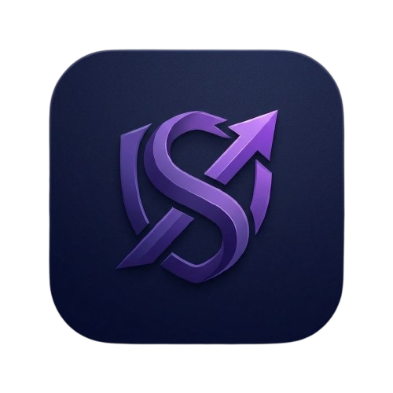

# ⚡ SyncPay (SmartFinance)

<p align="center">
  
</p>

<p align="center">
  <b>Gestão financeira pessoal inteligente, automatizada e offline-first.</b><br/>
  Intercepção nativa de notificações bancárias, controle orçamentário por categorias, gestão de carteiras e sincronização em nuvem em tempo real com Supabase.
</p>

<p align="center">
  
  
  
  
  
</p>

---

## 🎯 Sobre o SyncPay

O **SyncPay** (SmartFinance) resolve o principal atrito das aplicações de finanças pessoais: **o esquecimento ou preguiça de lançar gastos manualmente**.

Através de um **serviço nativo em segundo plano (Android NotificationListenerService)**, o SyncPay escuta, filtra e processa as notificações de bancos e carteiras digitais (como Nubank, PicPay, Inter, Itaú, Bradesco, Santander, etc.). As despesas e receitas são identificadas e categorizadas instantaneamente no momento em que você passa o cartão ou faz um Pix, mantendo seu saldo, limites e relatórios sempre em dia.

---

## ✨ Principais Funcionalidades

### 🤖 1. Automação Inteligente de Despesas & Receitas
- **Módulo Nativo de Intercepção:** Serviço em segundo plano em Kotlin que captura notificações apenas dos bancos autorizados pelo usuário.
- **Parser de Regex Avançado:** Identifica estabelecimentos, datas, horários e valores monetários (com suporte a vírgulas e pontos).
- **Filtro Anti-Promoções (Camada Dupla):** Blacklist nativa e em TypeScript que descarta notificações promocionais, cupons, ofertas, faturas fechadas, empréstimos e cashback antes de criar qualquer registro.
- **Feedback Imediato via Notificação Própria:** O SyncPay dispara um aviso local (*"💳 Gasto registrado: R$ 35,00 (Nubank)"*) confirmando a captura automática (podendo ser desativado nas configurações).

### ☁️ 2. Arquitetura Offline-First & Nuvem (Supabase)
- **Persistência Local Instantânea:** Os dados são salvos localmente via SQLite / Native Storage para funcionar mesmo sem sinal de internet.
- **Sincronização em Nuvem (Supabase):** Sincronização automática bidirecional para as tabelas `transactions`, `accounts`, `budgets` e `profiles`.
- **Troca de Aparelho Segura:** Ao entrar na conta em um novo smartphone, todo o histórico de transações, limites e carteiras é restaurado automaticamente.
- **Realtime Listener:** Se a conta estiver aberta em múltiplos dispositivos, novos lançamentos são refletidos instantaneamente.

### 💼 3. Gestão de Carteiras & Contas
- Cadastre múltiplas contas (Corrente, Poupança, Investimentos, Dinheiro, etc.).
- **Vínculo com Banco/Método:** Ao criar uma carteira (ex: "Cartão Nubank"), você pode atrelá-la ao banco padrão; lançamentos manuais puxam automaticamente essa configuração.
- Saldo dinâmico recalculado a cada nova despesa ou receita.

### 📊 4. Limites de Gastos & Orçamento Mensal
- Defina tetos de gastos mensais por categoria (Alimentação, Transporte, Lazer, Contas, Compras, etc.).
- Barra de progresso com alerta visual quando um limite atinge faixas críticas (80%, 100%+).
- Cálculo em tempo real dos gastos acumulados dentro do mês vigente.

### 📈 5. Métricas, Gráficos & Exportação
- Gráficos vetoriais de alta performance utilizando **React Native SVG**.
- Gráfico de barras de fluxo semanal de saídas.
- Histórico comparativo de receitas vs. despesas dos últimos 6 meses.
- Gráfico Donut de distribuição por categoria e ranking de gastos por banco.
- **Exportação de Relatórios:** Geração e compartilhamento de relatórios em formato CSV e texto formatado.

### 🛡️ 6. Segurança & Proteção de Dados
- **FLAG_SECURE Ativo:** A janela do app bloqueia capturas de tela (*print screens*) e gravações espiãs no Android, protegendo os dados bancários.
- **Supabase Row Level Security (RLS):** Cada usuário tem acesso estrito e isolado exclusivamente aos seus próprios registros.

### 🚀 7. Onboarding Animado & Perfil Customizável
- Fluxo de boas-vindas imersivo no primeiro acesso com animações fluidas para configuração rápida de limites e permissão de bancos.
- Personalização de perfil: edição de nome e seleção de foto/avatar.

---

## 🎨 Identidade Visual (Design System)

O SyncPay adota uma estética moderna, elegante e focada em produtividade:

| Elemento | Código HEX | Finalidade |
| :--- | :--- | :--- |
| **Fundo Profundo** | `#070b0e` | Background principal escuro e imersivo |
| **Superfícies / Cards** | `#0f171b` / `#141e24` | Contêineres de informações e modais |
| **Destaque Principal** | `#a855f7` | Roxo neon característico da marca |
| **Receitas (Entradas)** | `#34d399` | Verde esmeralda para valores positivos |
| **Despesas (Saídas)** | `#f87171` | Vermelho coral para saídas e alertas |

---

## 🛠️ Tecnologias & Ferramentas

- **Core:** [React Native](https://reactnative.dev/) (v0.87.1 Bare Workflow)
- **Linguagens:** [TypeScript](https://www.typescriptlang.org/) (Strict Mode) & [Kotlin](https://kotlinlang.org/)
- **Backend & Auth:** [Supabase](https://supabase.com/) (Auth, Database, Realtime)
- **Navegação:** [React Navigation](https://reactnavigation.org/) (Native Stack)
- **Armazenamento:** SQLite Nativo, `@react-native-async-storage/async-storage`
- **Gráficos:** `react-native-svg`
- **Animações:** `react-native-reanimated`
- **Testes Unitários:** [Jest](https://jestjs.io/) (100% de aprovação em 9 suítes e 62+ testes)

---

## 📁 Estrutura de Diretórios

```text
SmartFinance/
├── __tests__/                  # Suítes de testes unitários (Jest)
├── android/                    # Projeto nativo Android (Gradle, Kotlin, Manifest)
│   └── app/src/main/java/com/smartfinance/
│       ├── MainActivity.kt     # Janela principal com FLAG_SECURE
│       ├── NotificationModule.kt # Módulo nativo exposto para o React Native
│       └── NotificationService.kt# Listener nativo de notificações bancárias
├── src/
│   ├── assets/                 # Imagens, ícones e logotipo do app
│   ├── components/             # Modais, steps de onboarding e cards modulares
│   │   └── onboarding/         # WelcomeStep, BudgetStep, BanksStep
│   ├── context/                # Estados globais (AuthContext, FinanceContext)
│   ├── navigation/             # Configuração de rotas e navegação
│   ├── screens/                # Telas da aplicação (Home, Extrato, Limites, Gráficos, Perfil)
│   ├── services/
│   │   ├── parser/             # Motor de extração de dados e blacklist de ofertas
│   │   ├── notificationListener.ts # Bridge de eventos nativos
│   │   ├── syncService.ts      # Motor de sincronização com o Supabase
│   │   └── supabase.ts         # Inicialização do cliente Supabase
│   ├── theme/                  # Paleta de cores, tipografia e espaçamentos
│   ├── types/                  # Definições de tipos TypeScript
│   └── utils/                  # Formatadores e utilitários de cores de bancos
├── .env.example                # Modelo de variáveis de ambiente
└── package.json
```

---

## 🚀 Como Executar o Projeto Localmente

### Pré-requisitos
- Node.js (v18 ou superior)
- JDK 17 (Java Development Kit)
- Android Studio e Android SDK configurados (`ANDROID_HOME`)
- Dispositivo Android físico ou emulador com Google Play Services (API 28+)

### 1. Clonar o repositório
```bash
git clone https://github.com/Miguel-Ankido/SmartFinance.git
cd SmartFinance
```

### 2. Instalar dependências
```bash
npm install
```

### 3. Configurar variáveis de ambiente
Crie um arquivo `.env` na raiz do projeto com as credenciais do seu projeto Supabase:
```env
SUPABASE_URL=https://seu-projeto.supabase.co
SUPABASE_ANON_KEY=sua-chave-anonima-publica
```

### 4. Executar no Android
Inicie o Metro Bundler:
```bash
npm start
```

Em outro terminal, compile e instale o app no dispositivo:
```bash
npm run android
```

> **Dica para Testes de Notificação no Emulador:**  
> Você pode simular notificações bancárias via ADB executando:
> ```bash
> adb shell cmd notification post -t "Nubank" -S bigtext "nubank" "Compra de R$ 42,50 no Supermercado aprovada."
> ```

---

## 🧪 Executando os Testes

O projeto conta com ampla cobertura de testes cobrindo CRUD, cálculos financeiros, parser bancário, filtros de notificações e onboarding:

```bash
npm test
```

---

## 👨‍💻 Autor

**Miguel Nunes**  
GitHub: [@Miguel-Ankido](https://github.com/Miguel-Ankido)

---

## 📄 Licença

Este projeto é desenvolvido para fins de controle e automação financeira pessoal. Todos os direitos reservados.
